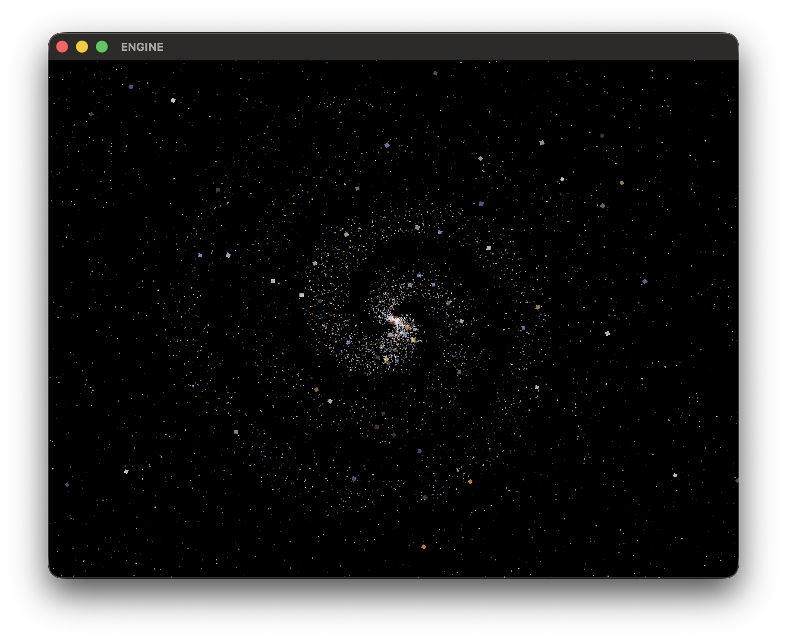
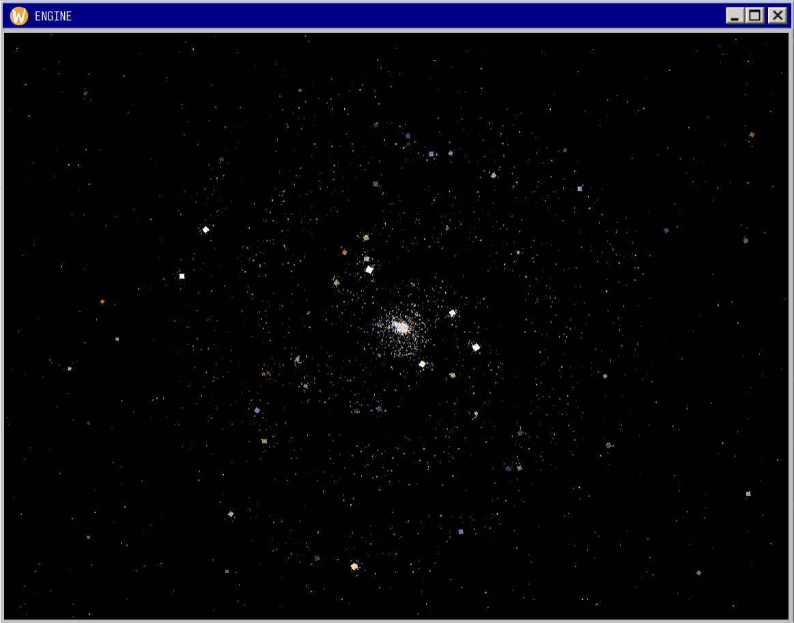
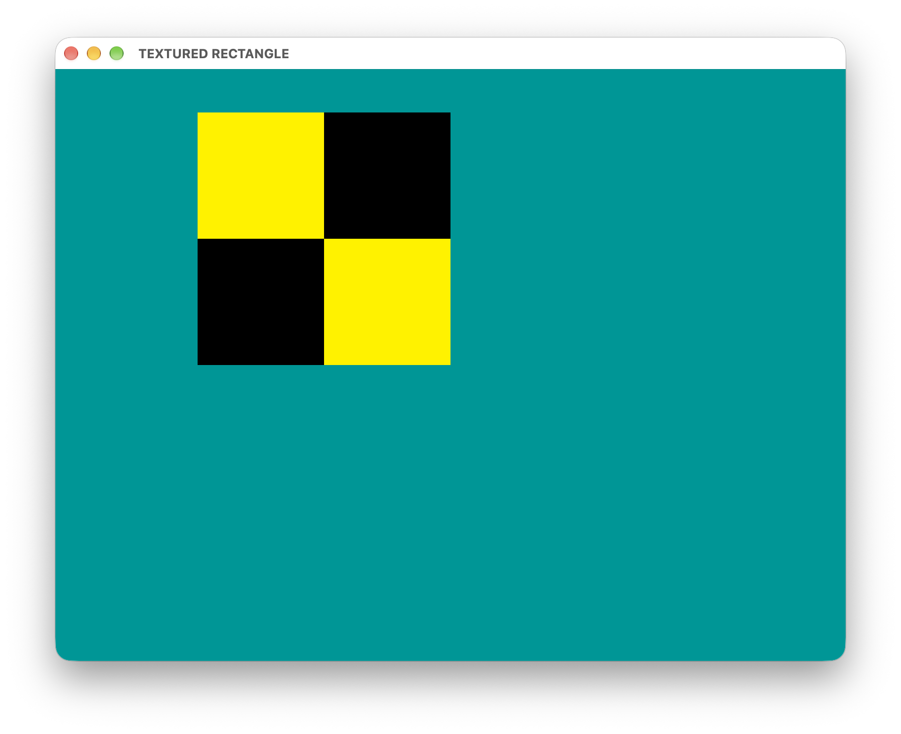
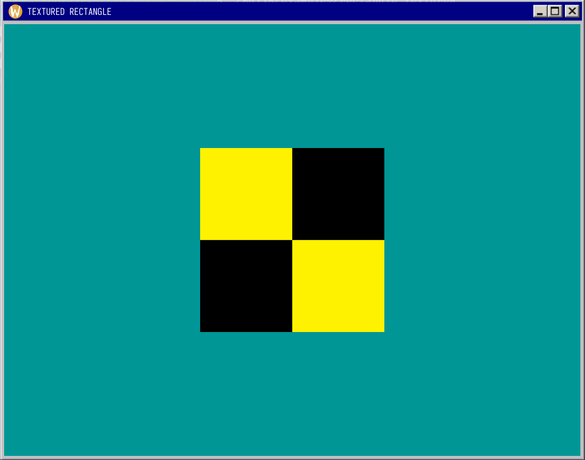

# GAME ENGINE
*Work in progess*

A small game engine for learning C programming language and graphics programming.

- Window & Input: GLFW
- Graphics API: OpenGL

## Features
- Window & keyboard input handling
- Basic math and utility libraries
- 2D Shape rendering
- 2D Texture rendering
- 2D view rendering
- Sprite rendering and animation

## Roadmap
- More 2D shapes
- Collision detection
- Camera controls
- Basic audio support
- Font rendering

*Example programs can be found in examples directory.*

## PREVIEW

    
Stars simulation

    
    

    
2D Texture

    
    

    
Sprite

    

